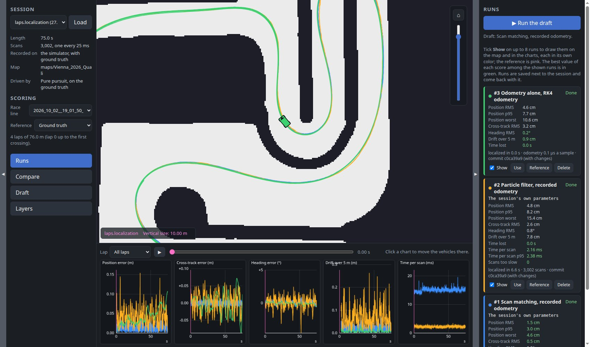
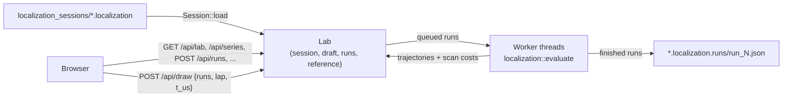

# Localization lab

`localization_lab` localizes a recorded drive again, offline, with every
localization algorithm and odometry, and compares them. Comparing them live
has two flaws: every try drives a different lap, and algorithms running side
by side compete for the CPU, so their cost means little. A session is
recorded once, and every run in the lab localizes that very same drive, one
run at a time.



## Recording a session

In `web_gui`'s Localization panel, select a map, then **Start recording**
and drive, by hand or with an autonomous algorithm, and **Stop & save**. The
session is a `.localization` file under `localization_sessions/`, holding
the sensors (lidar, IMU, odometry), the true pose in simulation, and a copy
of the map and its race lines. See
[Web GUI](web_gui.md#localization) and [SLAM](slam.md#localization-sessions)
for what's recorded and when it stops on its own.

**A fair drive.** In simulation, drive by hand or with an algorithm on the
ground truth (`pose_source` 1). An algorithm driving on localization's pose
makes the drive depend on the localization that ran. The panel warns while
it does, and the lab shows the same warning for a session recorded that way.

The real car records the same way: drive it once, then compare on a laptop.

## Running it

```sh
./target/release/localization_lab                                            # pick a session on the page
./target/release/localization_lab --file localization_sessions/laps.localization
```

Then open <http://localhost:1994>. Run it from the repository root, so it
finds `localization_sessions/` and `config/`.

| Option | Meaning |
|---|---|
| `--sessions-root DIR` | Folder to list `.localization` files from (default `localization_sessions`) |
| `--config-dir DIR` | Folder `localization/slam.toml`, `particle_filter.toml` and `dead_reckoning.toml` are read from and saved to (default `config`) |
| `--file PATH` | A session file to load right away |
| `--workers N` | How many runs localize at once (default 1, so each run's time per scan is measured alone) |
| `--bind-addr ADDR` | Address and port to serve on (default `0.0.0.0:1994`) |

## The page

**Session (left).** Pick a session and **Load** it. The details show its
length, its scans and the lidar's period, whether it was recorded in
simulation (with ground truth) or on the car, its map, and who drove.

**Scoring (left).** What every run is measured against:

- **Race line:** laps are counted along it, from the map's race lines. It
  starts as the one selected while recording.
- **Reference:** the ground truth in simulation. On the car there is none:
  pick a run instead, typically the most careful one, and every other run
  is scored against it. Its scores then say how far runs are from it, not
  from the truth.

Lap 0 runs up to the first forward crossing of the start/finish line, so the
start (and any convergence) doesn't skew lap 1.

**Runs (right).** **Run the draft** queues a run. Each run lists its
pipeline, what it changed from the session's parameters, and, once done,
its scores over the whole drive. **Show** draws it on the map and in the
charts, in its own color, up to 8 at once; the best value of each score
among the shown runs is in green. **Use** copies its pipeline into the
draft, **Reference** scores every run against it, and **Delete** forgets
it. Every finished run is saved beside its session
(`<session>.runs/run_<id>.json`, with the commit it was computed with) and
comes back when the session is loaded again.

**Compare (right).** One score of every finished run, per lap and for the
whole drive. The best of each column is in green.

**Draft (right).** The pipeline the next run localizes with. It starts as
what the session was recorded with:

- **Odometry:** as recorded, or the recorded IMU integrated again with
  Euler, midpoint or RK4, as `DeadReckoning` does live.
- **Algorithm:** scan matching or the particle filter, or none, to score
  odometry alone.
- **Parameters:** the chosen algorithm's sliders - the 13 SLAM parameters
  scan matching localizes with, or the particle filter's - with **Save**
  and **Load** to and from their config files, which `web_gui` starts with.
  **Reset to session** goes back to what the session was recorded with.

**The map.** The session's map, the reference in pink, every shown run's
trajectory, and every one's vehicle at the time picked under the map.
Every layer can be hidden from the **Layers** panel.

**The charts (under the map).** The shown runs over the **Lap** picked:
along the race line (meters) for one lap, over time for the whole session.
The slider (or **Play**, at real time) moves the vehicles on the map, and
clicking a chart moves them there.

| Chart | What it shows |
|---|---|
| Position error | Distance from the reference |
| Cross-track error | The error across the reference's heading, positive to its left |
| Heading error | In degrees |
| Drift over 5 m | How wrong the motion over the last 5 m driven is: what tells odometry settings apart, since alone odometry's absolute error only grows |
| Time per scan | How long the algorithm took on each scan |

## Scores

Each finished run is scored per lap and for the whole drive (see
`src/localization/evaluation.rs`).

| Score | What it measures |
|---|---|
| **Position** | Distance from the reference: RMS, 95th percentile and worst |
| **Cross-track** | RMS of the error across the reference's heading - what matters most to a car following a line |
| **Heading** | RMS of the heading error |
| **Drift** | RMS of the drift over 5 m |
| **Time lost** | How long the estimate was 0.5 m off or more |
| **Time per scan** | On average and 95th percentile; and how many scans took longer than the lidar's period, on which the algorithm would have fallen behind live |

**What's scored is the pose a driving algorithm reads**: odometry composed
onto the latest correction, at every odometry sample. A correction only
applies once its scan would have been processed live, its processing time
after the scan was taken, so a slower algorithm's estimate lags, as it
would on the car.

**Reading the times.** Runs localize one at a time by default, so their
times compare. The particle filter's own `threads` parameter still applies,
as live. With `--workers` above 1, runs compete for the CPU and their
times read higher.

## How it works



- **The same code as live.** Each run calls
  `aurorus::localization::evaluate`, which replays the session through the
  same steps the live `Slam` executor takes, and integrates odometry with
  `DeadReckoning`'s own step (see
  [SLAM](slam.md#localizing-a-session-offline)). The same session and
  pipeline always give the same trajectory; the particle filter's `seed`
  comes from its config file.
- **Scores on demand.** A run keeps its trajectory and scan costs only; its
  errors and scores are computed against the current reference and race
  line the first time they're asked for, and again after either changes.
- **No executors, no topics**, as in `mapping_lab`: the binary loads the
  session into memory and serves it. A run that panics is marked failed.
- **The same drawing protocol and frontend pieces as the other web UIs:**
  the map canvas (`map_view.js`, `draw_layers.js`), the parameter sliders
  (`parameter_panel.js`) and the chart helpers (`chart.js`).

### HTTP API

| Endpoint | What it does |
|---|---|
| `GET /api/sessions` | The session files, newest first |
| `POST /api/session` | Load a session, `{"name": "..."}` |
| `GET /api/lab` | The loaded session, the scoring, the draft and every run with its scores |
| `POST /api/race_line`, `/api/reference` | What runs are scored against: `{"file": "..."}`, `{"reference": {"kind": "ground_truth"}}` or `{"reference": {"kind": "run", "run": 3}}` |
| `POST /api/draft`, `/api/draft_reset` | The draft's odometry and algorithm, `{"odometry": "recorded", "algorithm": "particle_filter"}` |
| `POST /api/draft/scan_matching_parameter`, `..._parameters_save`, `..._parameters_load` | Scan matching's parameters in the draft; the same with `particle_filter` |
| `POST /api/runs` | Queue a run with the draft |
| `POST /api/runs/cancel`, `/api/runs/delete`, `/api/runs/use` | One run, `{"id": ...}` |
| `GET /api/series?runs=1,2&lap=N` | The runs' errors and scan costs over lap `N` (every lap without it), for the charts |
| `GET /api/colors` | The runs' colors, by position among the shown ones |
| `POST /api/draw`, `GET /api/draw/raster` | The map canvas |

### Where things are

| Path | What it is |
|---|---|
| `src/bin/localization_lab/lab.rs` | The session, the draft, the runs, the reference and the worker threads |
| `src/bin/localization_lab/api.rs` | The HTTP API and the drawings |
| `src/bin/localization_lab/static/` | The page: `index.html`, `style.css`, `app.js`, `charts.js` |
| `src/localization/evaluation.rs` | Localizing a session again, and scoring it |
| `src/localization/slam/localize.rs` | The replay through SLAM's localization |

## What's next

- **Several seeds.** The particle filter is random; running it with a few
  seeds and showing the spread would tell a better pipeline from a lucky
  one.
- **Sweeps**, as in `mapping_lab`: a run for every combination of a few
  parameters' values.
- **Global localization**: starting every run from nowhere, to compare how
  fast and how reliably each algorithm finds the car.
- **Reference-free scores on the car**: how well each estimate's scans line
  up with the map's walls, the same for every algorithm.
