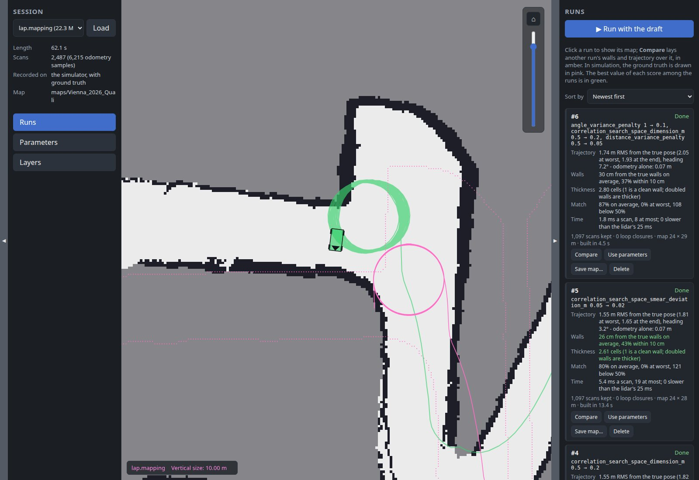
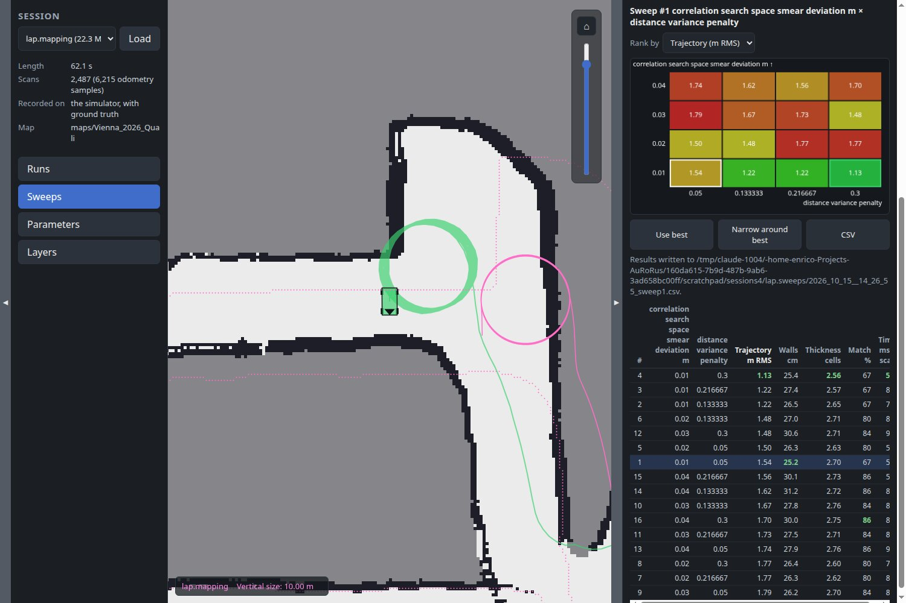
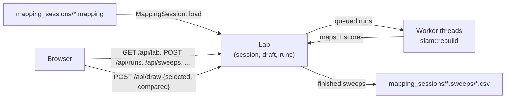

# Mapping lab

`mapping_lab` builds maps offline from a recorded mapping session, each time
with other SLAM parameters, and compares them. Tuning SLAM live has a flaw:
every try drives a different lap, so a better map may come from the
parameters or from a cleaner drive. A session is recorded once, and every
run in the lab maps that very same drive.



## Recording a session

In `web_gui`'s Mapping panel, turn **Record session** on, then map as usual:
Play on a cleared map starts the recording, and Clear, a successful Save map,
or turning the toggle off stops it. Each map gets a session of its own, a
`.mapping` file under `mapping_sessions/`. See
[SLAM](slam.md#mapping-sessions) for what's recorded and when.

The real car records the same way: drive it once, then tune on a laptop.

## Running it

```sh
./target/release/mapping_lab                                  # pick a session on the page
./target/release/mapping_lab --file mapping_sessions/lap.mapping
```

Then open <http://localhost:1995>. Run it from the repository root, so it
finds `mapping_sessions/`, `maps/` and `config/`.

| Option | Meaning |
|---|---|
| `--sessions-root DIR` | Folder to list `.mapping` files from (default `mapping_sessions`) |
| `--maps-root DIR` | Folder maps are saved into (default `maps`) |
| `--config-dir DIR` | Folder `localization/slam.toml` is read from and saved to (default `config`) |
| `--file PATH` | A session file to load right away |
| `--workers N` | How many runs are built at once (default: one per CPU core but one) |
| `--bind-addr ADDR` | Address and port to serve on (default `0.0.0.0:1995`) |

## The page

**Session (left).** Pick a session and **Load** it. Loading another one
forgets every run of the current one. The details show how long it is, how
many scans it has, whether it was recorded on the car or in simulation (with
ground truth), and the map it was recorded on.

**Parameters (right).** The draft: the parameters the next run is built
with, as sliders - the same 35 as `web_gui`'s Mapping panel. It starts as
the parameters the session was recorded with (its baseline). **Reset to
session** goes back to them. **Save to slam.toml** writes the draft into
`config/localization/slam.toml`, keeping its comments, which `web_gui`'s
SLAM starts with from then on; **Load from slam.toml** sets the draft to
the file's values. The switches (`draw`, `use_response_expansion`,
`do_loop_closing`) are read from the file and not tuned here.

**Runs (right).** **Run with the draft** queues a run. Runs are built in
parallel, one per worker thread, each taking roughly a fifth of the
session's length in a release build. Each run lists the parameters that
differ from the baseline and, once done, its [scores](#scores), how many
scans it kept, how many loops it closed, the map's size, and how long it
took to build. The best value of each score among the runs is in green, and
**Sort by** orders the runs by any score, best first.

**Show** picks which runs are listed: the ones queued by hand (the
default), every run, or one [sweep](#sweeps)'s. The shown and the compared
run are always listed.

Click a run to show its map. **Compare** lays another run's walls and
trajectory over it, in amber. **Use parameters** copies a run's parameters
into the draft, to tweak them further or save them. **Save map…** writes a
run's map as a new folder under `maps/`, exactly as **Save map** does in
`web_gui`. A parameter combination SLAM can't run with (a smear deviation
outside half to ten times its search's resolution) is refused when queued.

**The map.** The selected run is drawn as live SLAM draws it: the map, the
trajectory, loop closures, and the vehicle at the last scan. A session
recorded in simulation also has a **Ground truth** layer, in pink: the walls
of the map it was recorded on, and the true trajectory. Every layer, and
each of its parts, can be hidden from the **Layers** panel.

## Sweeps

A sweep is many runs queued at once: a run for every combination of up to
three parameters' values, each spread evenly over a range, with every
other parameter as in the draft. Runs queued by hand go before a sweep's,
so trying one thing by hand never waits for a whole sweep.



**Setting one up (the Sweeps panel).** Pick a parameter, its range
(**from**, **to**) and how many **values** to try; the values are listed
under it. **+ Parameter** adds a second and a third. Below, the panel says
how many runs that makes, how many are skipped and roughly how long it
takes. A sweep is refused past 200 runs. A combination SLAM can't run with
(a smear deviation outside half to ten times its search's resolution) is
skipped rather than failing, and shown as such. An integer parameter gets
each whole value once.

**Results.** Click a sweep to open it. **Rank by** picks the score the
chart and the table rank runs by: trajectory error when there's ground
truth, else wall thickness. The chart depends on how many parameters were
swept:

- **One:** the score over the parameter's values, with odometry's
  trajectory error as a dashed line for reference.
- **Two:** a heatmap, one cell per combination, from green (best) to red
  (worst); the best run is framed in green.
- **Three:** the heatmap of the first two, for the value of the third that
  the menu next to Rank by picks (the best run's at first). The colors
  span every slice, so slices compare.

The table lists every combination, best first; click a score's header to
rank by it. Click a cell or a row to show that run's map, as in the Runs
list. **Use best** copies the best run's parameters into the draft.
**Narrow around best** sets up a new sweep centered on the best run, over
half the range, to refine it. **CSV** downloads the results.

Once every run of a sweep is over (done, failed or cancelled), its results
are also written as CSV next to the session: `lap.sweeps/<when>_sweep<id>.csv`
beside `lap.mapping`, one row per combination with every score. Runs and
maps stay in memory only, so these files are what's left of a sweep after
the lab stops.

**Reading them.** SLAM is sensitive: a small change can make a scan match
somewhere else and change the map from there on, so neighboring cells can
differ a lot. Prefer a region of good cells to a single best one, and
check its map. The **Time** score is measured while every worker builds a
run, so in a sweep it reads several times higher than one run alone would.

## Scores

Each finished run is scored (see `src/localization/slam/scores.rs`). In
simulation, a session holds the truth: the true pose, and the map driven on.

| Score | What it measures | Needs |
|---|---|---|
| **Trajectory** | How far SLAM's poses are from the true pose at the same instant: RMS, worst and at the end, and the heading's RMS. SLAM's frame is placed in the world by the session's anchor, never fitted, so a map that drifted in heading scores badly. The same error for odometry alone is shown next to it: the baseline SLAM has to beat. | Ground truth |
| **Walls** | How far the map's walls (its occupied cells) are from the true map's, on average (each capped at 1 m), and the share within 10 cm. | The true map |
| **Thickness** | The map's occupied cells per occupied cell bordering free space: 1 for clean walls one cell thick, more where scans that don't line up doubled or smeared them. | - |
| **Match** | The match response of the kept scans: on average, at worst, and how many fell below 50%. | - |
| **Time** | How long a scan took to process, on average and at most, and how many took longer than the lidar's period (the session's median time between two scans): live, SLAM would have fallen behind on them. | - |

On the car only thickness, match and time are available: they're clues
rather than measurements, and a map can score well on them and still be
wrong, so look at it too.

## How it works



- **The same code as live SLAM.** Each run calls
  `aurorus::localization::rebuild`, which replays the session through the
  same steps the live `Slam` executor takes (see
  [SLAM](slam.md#rebuilding-a-session-offline)). The same session and
  parameters always give the same map.
- **No executors, no topics.** Like `replay_web_gui`, the binary has no
  `Runner` and no `Captain`: it loads the session into memory and serves it.
  A run that panics is marked failed; it doesn't take its worker down.
- **The same drawing protocol as the other web UIs.** `POST /api/draw` and
  `GET /api/draw/raster` behave as described in
  [Web GUI](web_gui.md#drawings), so the canvas code (`map_view.js`,
  `draw_layers.js`) is shared unchanged. The page sends which runs are
  selected and compared with every `POST /api/draw`; a run's layer is
  versioned by the run's id. A run's drawings are built the first time it
  is shown, not when it finishes: most of a sweep's runs never are. The parameter sliders are `web_gui`'s too
  (`/parameter_panel.js`).

### HTTP API

| Endpoint | What it does |
|---|---|
| `GET /api/sessions` | The session files, newest first |
| `POST /api/session` | Load a session, `{"name": "..."}` |
| `GET /api/lab` | The loaded session, the draft and every run with its stats |
| `POST /api/draft_parameter`, `/api/draft_parameters_save`, `/api/draft_parameters_load`, `/api/draft_reset` | The draft |
| `POST /api/runs` | Queue a run with the draft |
| `POST /api/runs/cancel`, `/api/runs/delete`, `/api/runs/use` | One run, `{"id": ...}` |
| `POST /api/runs/save_map` | Save a run's map, `{"id": ..., "name": "..."}` |
| `POST /api/sweeps/plan` | What a sweep would queue, `{"axes": [{"name", "from", "to", "count"}, ...]}`: each axis' values, and how many runs and skips |
| `POST /api/sweeps` | Queue a sweep, the same body |
| `POST /api/sweeps/cancel`, `/api/sweeps/delete` | One sweep and its runs, `{"id": ...}` |
| `GET /api/sweeps/csv?id=...` | A sweep's results as CSV |
| `POST /api/draw`, `GET /api/draw/raster` | The map canvas |

### Where things are

| Path | What it is |
|---|---|
| `src/bin/mapping_lab/lab.rs` | The session, the draft, the runs, the sweeps and the worker threads |
| `src/bin/mapping_lab/sweep.rs` | A sweep's values, its combinations and its CSV |
| `src/bin/mapping_lab/api.rs` | The HTTP API and the drawings |
| `src/bin/mapping_lab/static/` | The page |
| `src/localization/mapping_session.rs` | The session file: what's recorded, and reading it back |
| `src/localization/slam/rebuild.rs` | Building a session's map again, and its drawings |
| `src/web/parameter_panel.js` | The parameter sliders, shared with `web_gui` |

## What's next

1. **Random sampling.** A grid grows fast past three parameters: sampling
   N combinations at random over every parameter's range would cover more
   of them for the same number of runs.
2. **Several sessions at once.** Parameters that win on one lap may not on
   another: scoring each combination over several sessions would pick
   parameters that hold up.
3. **More clues on the car**, where there's no ground truth: how far the
   pose jumped when a loop closed, which says how much it had drifted.
4. **Dead reckoning offline.** Sessions record `imu` too: integrating it
   again would tune dead reckoning's parameters together with SLAM's.
