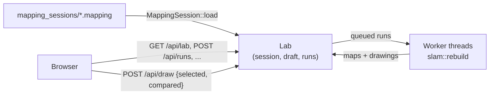

# Mapping lab

`mapping_lab` builds maps offline from a recorded mapping session, each time
with other SLAM parameters, and compares them. Tuning SLAM live has a flaw:
every try drives a different lap, so a better map may come from the
parameters or from a cleaner drive. A session is recorded once, and every
run in the lab maps that very same drive.


## Recording a session

In `web_gui`'s Mapping panel, turn **Record session** on, then map as usual:
Play on a cleared map starts the recording, and Clear, a successful Save map,
or turning the toggle off stops it. Each map gets a session of its own, a
`.mapping` file under `mapping_sessions/`. See
[SLAM](slam.md#mapping-sessions) for what's recorded and when.

The real car records the same way: drive it once, then tune on a laptop.

## Running it

```sh
./target/release/mapping_lab                                  # pick a session on the page
./target/release/mapping_lab --file mapping_sessions/lap.mapping
```

Then open <http://localhost:1995>. Run it from the repository root, so it
finds `mapping_sessions/`, `maps/` and `config/`.

| Option | Meaning |
|---|---|
| `--sessions-root DIR` | Folder to list `.mapping` files from (default `mapping_sessions`) |
| `--maps-root DIR` | Folder maps are saved into (default `maps`) |
| `--config-dir DIR` | Folder `localization/slam.toml` is read from and saved to (default `config`) |
| `--file PATH` | A session file to load right away |
| `--workers N` | How many runs are built at once (default: one per CPU core but one) |
| `--bind-addr ADDR` | Address and port to serve on (default `0.0.0.0:1995`) |

## The page

**Session (left).** Pick a session and **Load** it. Loading another one
forgets every run of the current one. The details show how long it is, how
many scans it has, whether it was recorded on the car or in simulation (with
ground truth), and the map it was recorded on.

**Parameters (right).** The draft: the parameters the next run is built
with, as sliders - the same 35 as `web_gui`'s Mapping panel. It starts as
the parameters the session was recorded with (its baseline). **Reset to
session** goes back to them. **Save to slam.toml** writes the draft into
`config/localization/slam.toml`, keeping its comments, which `web_gui`'s
SLAM starts with from then on; **Load from slam.toml** sets the draft to
the file's values. The switches (`draw`, `use_response_expansion`,
`do_loop_closing`) are read from the file and not tuned here.

**Runs (right).** **Run with the draft** queues a run. Runs are built in
parallel, one per worker thread, each taking roughly a fifth of the
session's length in a release build. Each run lists the parameters that
differ from the baseline, and once done:

- how many scans it kept and how many loops it closed;
- how well scans matched, on average and at worst;
- how long a scan took to process, on average and at most - a run much
  slower than the lidar's rate couldn't keep up live;
- the map's size, and how long the run took.

Click a run to show its map. **Compare** lays another run's walls and
trajectory over it, in amber. **Use parameters** copies a run's parameters
into the draft, to tweak them further or save them. **Save map…** writes a
run's map as a new folder under `maps/`, exactly as **Save map** does in
`web_gui`. A parameter combination SLAM can't run with (a smear deviation
outside half to ten times its search's resolution) is refused when queued.

**The map.** The selected run is drawn as live SLAM draws it: the map, the
trajectory, loop closures, and the vehicle at the last scan. A session
recorded in simulation also has a **Ground truth** layer, in pink: the walls
of the map it was recorded on, and the true trajectory. Every layer, and
each of its parts, can be hidden from the **Layers** panel.

## How it works



- **The same code as live SLAM.** Each run calls
  `aurorus::localization::rebuild`, which replays the session through the
  same steps the live `Slam` executor takes (see
  [SLAM](slam.md#rebuilding-a-session-offline)). The same session and
  parameters always give the same map.
- **No executors, no topics.** Like `replay_web_gui`, the binary has no
  `Runner` and no `Captain`: it loads the session into memory and serves it.
  A run that panics is marked failed; it doesn't take its worker down.
- **The same drawing protocol as the other web UIs.** `POST /api/draw` and
  `GET /api/draw/raster` behave as described in
  [Web GUI](web_gui.md#drawings), so the canvas code (`map_view.js`,
  `draw_layers.js`) is shared unchanged. The page sends which runs are
  selected and compared with every `POST /api/draw`; a run's layer is
  versioned by the run's id. The parameter sliders are `web_gui`'s too
  (`/parameter_panel.js`).

### HTTP API

| Endpoint | What it does |
|---|---|
| `GET /api/sessions` | The session files, newest first |
| `POST /api/session` | Load a session, `{"name": "..."}` |
| `GET /api/lab` | The loaded session, the draft and every run with its stats |
| `POST /api/draft_parameter`, `/api/draft_parameters_save`, `/api/draft_parameters_load`, `/api/draft_reset` | The draft |
| `POST /api/runs` | Queue a run with the draft |
| `POST /api/runs/cancel`, `/api/runs/delete`, `/api/runs/use` | One run, `{"id": ...}` |
| `POST /api/runs/save_map` | Save a run's map, `{"id": ..., "name": "..."}` |
| `POST /api/draw`, `GET /api/draw/raster` | The map canvas |

### Where things are

| Path | What it is |
|---|---|
| `src/bin/mapping_lab/lab.rs` | The session, the draft, the runs and the worker threads |
| `src/bin/mapping_lab/api.rs` | The HTTP API and the drawings |
| `src/bin/mapping_lab/static/` | The page |
| `src/localization/mapping_session.rs` | The session file: what's recorded, and reading it back |
| `src/localization/slam/rebuild.rs` | Building a session's map again, and its drawings |
| `src/web/parameter_panel.js` | The parameter sliders, shared with `web_gui` |

## What's next

1. **Scores.** Numbers to rank runs by, beyond what each run reports now. In
   simulation, against the ground truth the session holds: the error of the
   trajectory (SLAM's poses placed in the world against the true ones), and
   how well the map's walls fit the true map's. On the car, with no ground
   truth: how far the pose jumped when a loop closed, and how sharp the
   walls are (a doubled or blurred map has thicker walls). With scores, the
   runs list can be sorted.
2. **Parameter sweeps**, the step after manual runs: ranges for one or more
   parameters (e.g. `correlation_search_space_smear_deviation_m` from 0.03
   to 0.08 by 0.01, times `loop_match_minimum_response_fine` from 0.35 to
   0.55 by 0.05), every combination queued and run in parallel, and a
   sortable table and a score heatmap to choose from. Sweeps are many manual
   runs queued at once, so they build on what's here, but they need the
   scores to be worth it: 30 maps can't be compared by eye.
3. **Dead reckoning offline.** Sessions record `imu` too: integrating it
   again would tune dead reckoning's parameters together with SLAM's.
